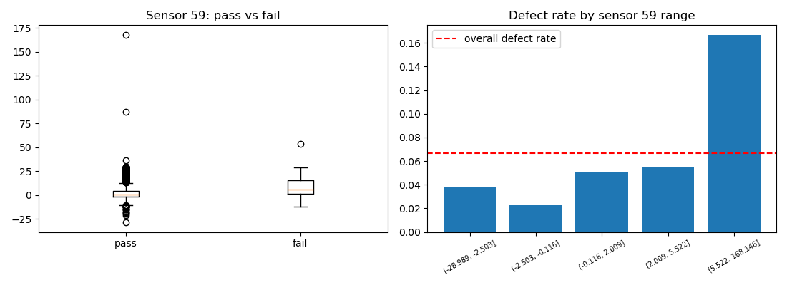
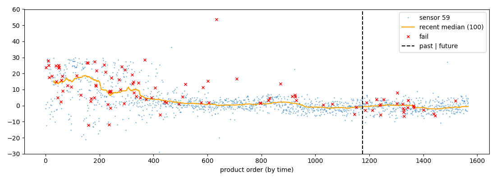

# SECOM 반도체 공정 불량 예측 — 좋아 보이는 점수를 끝까지 의심하기

반도체 공정 센서 데이터(UCI SECOM)로 불량을 예측하면서, **무작위 평가에서 좋아 보이던 성능이 실제 운영 조건(과거로 학습 → 미래 예측)에서도 유지되는지** 단계별로 검증한 분석입니다.

## 핵심 결론

| 질문 | 결과 |
|---|---|
| 무작위 교차 검증 성능은? | 부스팅 모델 PR-AUC **0.213** (기준선 0.066의 약 3배) |
| 그 점수는 센서 덕분인가? | **생산 순서 숫자 하나만으로 0.174** → 점수의 약 80%가 시기 효과 |
| 시간 순서로 평가하면? | 기준선 대비 평균 +0.093, 라벨 섞기 검정 **p ≈ 0.02** → 약하지만 우연은 아닌 신호 |
| 왜 불안정한가? | 과거와 미래 데이터를 **AUC 0.993**으로 구분할 수 있을 만큼 공정이 넓게 바뀜 |
| 변한 센서를 빼면? | 미래 정보를 써서 골라도 **개선되지 않음** |

**결론:** 이 센서 데이터만으로는 안정적인 불량 예측이 어렵다. 운영하려면 ① 드리프트 센서(116·543·132번 등) 감시 ② 변화 감지 시 최근 데이터로 재학습 ③ 장비·레시피 변경 이력 같은 공정 정보가 필요하다.

## 데이터

- [UCI SECOM](https://archive.ics.uci.edu/dataset/179/secom): 반도체 생산 기록 1,567개 × 센서 590개, 생산 시각, 합격/불량 라벨
- 불량 104개(**6.6%**) — 심한 불균형
- 빈칸 41,951개, 값이 항상 같은 센서 116개 → 정리 후 **센서 446개** 사용

## 분석 흐름

| 단계 | 파일 | 질문 |
|---|---|---|
| 1 | `step1.py` | 데이터는 어떻게 생겼나? |
| 2 | `step2.py` | 첫 모델은 얼마나 잘하나? |
| 3 | `step3.py` | 불량을 더 잡으려면? (임계값) |
| 4 | `step4.py` | 실험을 어떻게 기록하나? (MLflow) |
| 5 | `step5.py` | 정상만 배우는 이상 탐지는? (PyTorch 오토인코더) |
| 6 | `step6.py` | 믿을 수 있는 방식으로 모델을 비교하면? (교차 검증) |
| 7–8 | `step7.py`, `step8.py` | 어떤 센서가 중요한가? |
| 9 | `step9.py` | 중요 센서(59번)는 불량과 어떻게 관련 있나? |
| 10–12 | `step10.py`–`step12.py` | 시간 순서로 평가해도 통하나? |
| 13–16 | `step13.py`–`step16.py` | 왜 무너졌나? 무엇으로 대응할 수 있나? |

---

## 1. 데이터 파악 · 정확도의 함정 (step1–2)

- **문제:** 불량이 6.6%뿐이다.
- **실험:** 랜덤 포레스트로 첫 모델을 만들었다.
- **결과:** 정확도 **93.3%**, 그러나 시험용 불량 21개 중 **0개**를 잡았다(recall 0). 무조건 "합격"이라고 답하는 모델과 같다.

> ✍️ 배운 점: (직접 작성)

## 2. 임계값과 recall·precision의 맞바꿈 (step3–4)

| 임계값 | 잡은 불량 (21개 중) | 헛경보 (합격 293개 중) |
|---|---|---|
| 0.2 | 1 | 4 |
| 0.1 | 8 | 48 |
| 0.05 | 17 | 168 |

- 불량을 더 잡으려 기준을 낮추면 헛경보가 급격히 늘었다. 0.05에서는 합격품의 57%를 재검사해야 한다.
- 모든 설정과 결과를 **MLflow**에 기록해 비교했다.

> ✍️ 배운 점: (직접 작성)

## 3. 오토인코더 이상 탐지 (step5)

- **가설:** 정상 데이터만 학습한 오토인코더의 복원 오차가 크면 불량일 것이다.
- **결과:** 같은 헛경보 수준에서 랜덤 포레스트보다 불량을 덜 잡았고, precision이 0.06~0.08로 **불량 비율(0.067)과 비슷한 무작위 수준**이었다.
- 라벨이 있을 때는 지도 학습이 낫고, 이 데이터에서 "정상과 다름"이 곧 "불량"은 아니었다.

> ✍️ 배운 점: (직접 작성)

## 4. 교차 검증으로 모델 비교 (step6)

5-fold 교차 검증, PR-AUC (기준선 0.066)

| 모델 | PR-AUC | ROC-AUC |
|---|---|---|
| LogisticRegression | 0.149 ± 0.022 | 0.661 |
| RandomForest | 0.156 ± 0.023 | 0.680 |
| **HistGradientBoosting** | **0.213 ± 0.038** | **0.729** |

- LogisticRegression과 RandomForest의 차이(0.007)는 흔들림(±0.02)보다 작아 **같다고 판단**했다.
- 빈칸 채우기를 Pipeline에 넣어 fold마다 공부용 데이터로만 채우게 해 데이터 누수를 막았다.

> ✍️ 배운 점: (직접 작성)

## 5. 중요 센서 찾기 (step7–9)

- 한 번 나눠 잰 순열 중요도에서는 59, 103, 33, 587번이 상위였다.
- 한계를 보완하기 위해 **상관이 높은 센서끼리 묶어(446개 → 232묶음) 함께 섞고, 5-fold 각각에서 중요도를 재** 상위 10위에 든 횟수를 셌다.
  - **59번만 5번 중 5번** 상위권이었다.
  - 처음 2위였던 103번은 상위 10에서 사라졌다(우연).
  - 587번은 588번과 같은 정보를 나눠 갖고 있었다.
- 59번 값 상위 20% 구간의 불량률은 **16.7%**(전체의 2.5배)로, 불량의 절반이 이 구간에 있었다.



> ✍️ 배운 점: (직접 작성)

## 6. 시간 순서로 평가하자 무너진 성능 (step10–12)

실제 공장처럼 **과거 75%로 학습하고 미래 25%를 예측**했다.

| | 결과 |
|---|---|
| 미래 PR-AUC | **0.065** (기준선 0.061, 사실상 무작위) |
| 59번 규칙 (과거 기준 > 8.56) | 미래에는 1%만 해당, 불량 **0/24개** |
| "최근 평소 대비" 규칙 | 검사 14%, 불량 2/24개 |

59번 센서를 시간 순서로 그려 보니, **생산 초기 불안정기에 59번 값과 불량이 함께 높았고** 이후에는 값이 0 근처로 안정되며 관계가 사라졌다.



walk-forward(6구간, 직전까지 학습 → 다음 구간 예측) 결과:

| 구간 | 불량 | 기준선 | 과거 전체로 학습 | 최근 400개로 학습 |
|---|---|---|---|---|
| 2 | 6 | 0.023 | 0.031 | 0.019 |
| 3 | 10 | 0.038 | 0.356 | 0.062 |
| 4 | 13 | 0.050 | 0.072 | 0.074 |
| 5 | 14 | 0.053 | 0.076 | 0.276 |

> ✍️ 배운 점: (직접 작성)

## 7. 원인 검증과 대응 (step13–16)

**실험 1 — 시간만으로 불량 맞히기 (step13)**

| 재료 | PR-AUC (무작위 5-fold) |
|---|---|
| 센서 446개 | 0.213 ± 0.038 |
| **생산 순서 숫자 1개** | **0.174 ± 0.030** |
| 59번 센서 1개 | 0.104 ± 0.018 |

센서 없이 생산 순서만으로 센서 모델 점수의 약 80%가 나왔다. 무작위 평가 점수의 대부분은 **시기 효과(교란)** 였다.

**실험 2 — 라벨 섞기 검정 (step14)**

walk-forward의 기준선 대비 향상을, 정답을 무작위로 섞은 가짜 실험 50번과 비교했다.

| 방식 | 진짜 향상 | 우연 상위 5% | p값 |
|---|---|---|---|
| 과거 전체로 학습 | +0.093 | +0.040 | 0.020 |
| 최근 400개로 학습 | +0.066 | +0.039 | 0.020 |

시간 순서를 지켜도 **우연을 넘는 약한 신호**는 있었다. 다만 향상의 대부분이 한 구간에서 나왔다.

**실험 3 — 적대적 검증 (step15)**

- 모델에게 "과거 제품인가, 미래 제품인가"를 맞히게 했더니 **AUC 0.993**. 공정이 크게 바뀌었다.
- 적대적 검증과 KS 통계량 모두에서 상위 20에 든 센서: **34, 45, 58, 116, 132, 543, 544, 545**
- 59번은 56위·91위. 59번의 변화는 초기에, 116·543번 등의 변화는 후반에 있어 **공정 변화가 최소 두 번** 있었던 것으로 보인다.

**마지막 확인 — 드리프트 센서 빼기 (step16)**

| 센서 조합 | 과거 전체 | 최근 400개 |
|---|---|---|
| 446개 전부 | +0.093 | +0.066 |
| 드리프트 8개 제외 | +0.075 | +0.074 |
| 적대적 상위 20개 제외 | +0.101 | +0.057 |

드리프트 목록은 미래 데이터로 찾은 것이라 **유리하게 준 상한선**인데도 일관된 개선이 없었다. 변화가 공정 전체에 퍼져 있어 센서 몇 개를 빼는 것으로는 해결되지 않는다.

> ✍️ 배운 점: (직접 작성)

---

## 한계

- 불량이 104개뿐이라 구간별·fold별 점수가 크게 흔들린다.
- 라벨 섞기 검정은 50번만 반복했고, 정답을 완전히 섞어 불량의 시간적 몰림까지 없앴으므로 다소 너그러운 검정이다.
- 센서 묶기(상관 기반)는 전체 데이터로 했다. 정답은 보지 않았지만, 엄밀하게는 fold마다 묶어야 한다.
- 센서의 실제 의미와 공정 변경 이력이 공개되지 않아 원인을 확정할 수는 없다.

## 실행 방법

```bash
pip install -r requirements.txt
python step1.py      # 단계별로 실행
mlflow ui            # http://127.0.0.1:5000 에서 실험 비교
```

데이터는 UCI 저장소에서 코드가 직접 내려받는다.

## 기술 스택

Python · pandas · scikit-learn · PyTorch · MLflow · SciPy · matplotlib
